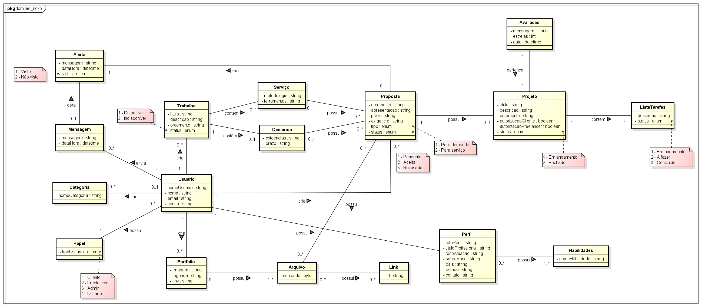

# Trabalho sobre Arquitetura Limpa: Entrega 01

O que deve ser feito:

1. A partir do diagrama de classes de domínio, **escolher 3 ou 4 classes** para serem implementadas neste trabalho.
2. Criar um projeto no VS Code **usando "Python Puro"**, sem ser um projeto Django ou Django-REST
3. Criar a modelagem das classes de domínio, dos Repositories e das interfaces DAO conforme a imagem de exemplo ([core_UML_TRABALHO.png](diagramas/core_UML_TRABALHO.png))
4. Fazer a implementação das classes e interfaces modeladas em Python

Entregar o arquivo "zipado" do projeto contendo a implementação e com a imagem do diagrama de modelagem das classes.

## Diagrama de Domínio - Nexo



## Imagem de exemplo - Core


# Nexo — Django + Arquitetura Limpa

Projeto Django que utiliza o **core** implementado na ENTREGA-01 e segue o projeto da atividade 11
(*Mudando de SQL Puro para ORM*). Possui páginas web com o CRUD de **Trabalho**, **Serviço**,
**Demanda** e **Proposta**.

## Como executar

```bash
python -m venv .venv
source .venv/bin/activate        # Windows: .venv\Scripts\activate
pip install -r requirements.txt
python manage.py runserver
```

Acesse http://127.0.0.1:8000/

O arquivo `db_nexo.sqlite3` já acompanha o projeto (vazio). Para recriar as tabelas:
`python manage.py criar_banco` (usa `banco/schema.sql`).

Testes: `python manage.py test`

## Estrutura

```
core/                       # Core da ENTREGA-01 (Python puro, sem Django)
  entities/                 # Trabalho, Servico, Demanda, Proposta
  ports/idao/               # Interfaces: ITrabalhoDAO, IServicoDAO, ..., IConexaoBD
  use_cases/repositories/   # Repositories (validações / regras de negócio)
  use_cases/dao/            # DAOs fake em memória (ENTREGA-01)
  factory.py

app/                        # Aplicação Django (implementação)
  models.py                 # TrabalhoModel, ServicoModel, DemandaModel, PropostaModel
  dao.py                    # ConexaoBD_ORM e TrabalhoDAO_ORM, ServicoDAO_ORM, DemandaDAO_ORM, PropostaDAO_ORM
  factory.py                # ServicosFactory: usa os DAOs ORM no lugar dos DAOs em memória
  forms.py  views.py        # Formulários e views dos CRUDs
  templates/ static/        # Páginas (*_listar.html e *_editar.html) e CSS

proj_nexo/                  # Configurações do projeto Django
banco/schema.sql            # Criação das tabelas
diagramas/                  # Diagramas da ENTREGA-01
```

Fluxo: `View → ServicosFactory → Repository (core) → IDAO (core) → DAO_ORM (app) → ORM → SQLite`

## Rotas (para cada recurso: trabalhos, servicos, demandas, propostas)

| Rota                         | Função                                  |
|------------------------------|-----------------------------------------|
| `<recurso>/`                 | Listagem                                |
| `<recurso>/incluir/`         | Formulário de inclusão                  |
| `<recurso>/alterar/<id>/`    | Formulário de alteração                 |
| `<recurso>/excluir/<id>/`    | Confirmação de exclusão                 |
| `<recurso>/salvar/` (POST)   | Inclui, altera ou exclui o registro     |

## Ajustes feitos no core da ENTREGA-01

- Imports padronizados para `core.*` (antes misturavam `src.core.*` e `core.*`).
- `Demanda`: o atributo `trabalho` não era atribuído no construtor.
- `ServicoDAO` e `DemandaDAO` (em memória): corrigidos conflitos de nome e retornos.
- `DemandaRepository.excluir` não valida mais o objeto antes de excluir.
- Adicionada a interface `IConexaoBD` em `core/ports/idao/` e `__init__.py` nos pacotes.
